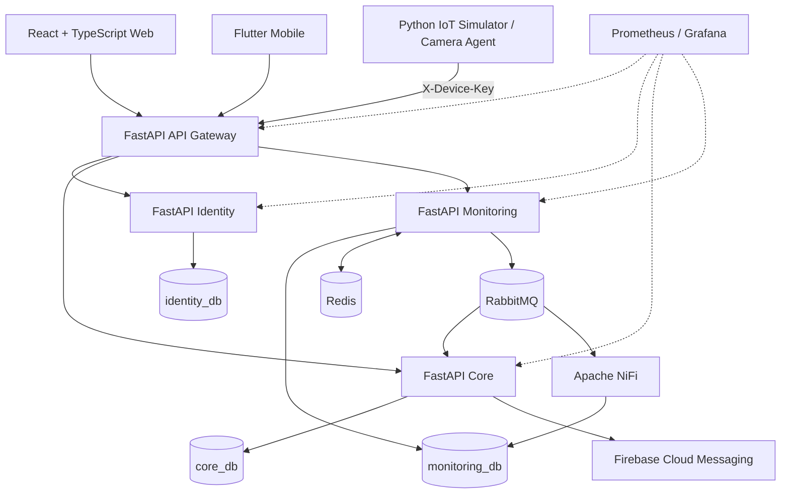

# 🍄 Smart Mushroom Cultivation Management System

**Hệ thống quản lý nuôi trồng nấm thông minh tích hợp cho thuê khay và giám sát từ xa**  
*Smart Mushroom Cultivation Management System with Rental and Remote Monitoring*

Dự án môn **Xây dựng phần mềm hướng đối tượng**, triển khai theo kiến trúc **microservices / SOA**. Hệ thống cho phép khách hàng thuê khay trồng nấm, theo dõi chu kỳ nuôi, xem ảnh camera và dữ liệu nhiệt độ/độ ẩm; đồng thời cung cấp công cụ quản trị trang trại, thiết bị và cảnh báo.

> **Tài liệu chuẩn:** SRS **v2.5 Final**. README này thay thế tài liệu cũ dùng Node.js/Express, Prisma, Supabase và SRS v2.1. Các lệnh và cổng bên dưới được đối chiếu với bản source Docker Compose đã cung cấp; nếu nhánh GitHub mới nhất có thay đổi, ưu tiên cấu hình thực tế trong repository.

## ✨ Chức năng chính

| Vai trò | Chức năng |
|---|---|
| **Administrator** | Quản lý tài khoản và phân quyền; phòng, khay, gói thuê; thiết bị; cấu hình hệ thống; xét duyệt yêu cầu kết thúc thuê trước hạn. |
| **Farm Operator** | Quản lý chu kỳ nuôi, duyệt giống nấm tự nhập, cập nhật giai đoạn, thu hoạch/loại bỏ, theo dõi thiết bị và xử lý bàn giao. |
| **Customer** | Đăng ký/đăng nhập, chọn gói và khay, thuê khay bằng thanh toán mô phỏng, xem **Khay của tôi**, theo dõi camera/cảm biến, nhận thông báo và yêu cầu kết thúc thuê sớm. |
| **Thiết bị mô phỏng** | Gửi dữ liệu cảm biến và ảnh JPEG thông qua API IoT sử dụng `X-Device-Key`. |

**Một số quy tắc nghiệp vụ quan trọng:**

- **Thuê khay:** tạo đơn `ACTIVE` sau thanh toán mô phỏng; sử dụng khóa hàng PostgreSQL (`FOR UPDATE ... SKIP LOCKED`) để tránh đặt trùng khay.
- **Chu kỳ nuôi:** `SEEDING → INCUBATING → FRUITING → READY`; chỉ thu hoạch ở giai đoạn phù hợp. Giống tự nhập cần Operator phê duyệt.
- **Hết hạn thuê:** tác vụ chạy theo lịch, hỗ trợ chạy lại an toàn (*idempotent*); chỉ giải phóng khay khi các chu kỳ đang nuôi đã kết thúc.
- **Kết thúc thuê sớm:** cần thỏa điều kiện nghiệp vụ, Admin duyệt, xác nhận hoàn tiền **ngoài hệ thống** và Operator xác nhận bàn giao. Công thức hoàn tiền dự kiến: `giá thuê × (số ngày còn lại / tổng số ngày) × 70%`.
- **Quyền giám sát:** Customer chỉ xem camera/telemetry của phòng khi có đơn thuê hợp lệ; khi không xác minh được quyền, hệ thống từ chối truy cập (*fail closed*).
- **Thông báo:** lưu trong database; Firebase Cloud Messaging (FCM) dùng để đẩy thông báo lên Flutter, lỗi push không được làm rollback nghiệp vụ chính.

## 🏗️ Kiến trúc



Ba service nghiệp vụ sử dụng **ba PostgreSQL database logic riêng**; các tham chiếu xuyên service được xử lý ở tầng ứng dụng, không dùng foreign key xuyên database.

### Công nghệ

| Lớp | Công nghệ |
|---|---|
| Backend / Gateway | Python, FastAPI, REST, JWT (HS256), Swagger/OpenAPI |
| Web | React, TypeScript, Vite; Nginx khi chạy bằng Docker |
| Mobile | Flutter, Firebase Cloud Messaging |
| Database | PostgreSQL 16, SQL migrations |
| Cache | Redis (latest telemetry, fallback PostgreSQL) |
| Message broker | RabbitMQ (`telemetry.events`) |
| Xử lý dữ liệu | Apache NiFi (tổng hợp telemetry theo cửa sổ 5 phút) |
| Observability | Prometheus, Grafana |
| IoT demo | Python sensor simulator / camera agent |
| DevOps | Docker Compose, GitHub, Jira, Confluence |

### Các cổng khi chạy Docker Compose

| Thành phần | URL / cổng mặc định | Ghi chú |
|---|---|---|
| Web | `http://localhost:8080` | Nginx phục vụ web, proxy API |
| API Gateway | `http://localhost:8000` | REST API, IoT |
| RabbitMQ Management | `http://localhost:15672` | Dùng thông tin trong `.env` |
| Apache NiFi | `https://localhost:8443/nifi` | HTTPS, có thể gặp cảnh báo chứng chỉ local |
| Prometheus | `http://localhost:9090` | Metrics |
| Grafana | `http://localhost:3000` | Dashboard |
| PostgreSQL / Redis | Nội bộ Docker network | Không publish ra host trong Compose tham chiếu |

> **Lưu ý:** Web Vite khi chạy dev trực tiếp thường dùng `http://localhost:5173`. Đây **không phải** cổng của bản web chạy qua Docker/Nginx (`8080`).

## 🚀 Chạy dự án bằng Docker

### Yêu cầu

- Git và Docker Desktop (có Docker Compose v2).
- Máy đủ RAM để chạy PostgreSQL, NiFi, RabbitMQ, Grafana và các service cùng lúc.
- Firebase service account chỉ cần khi muốn thử push FCM thật; chế độ `FCM_DRY_RUN=true` phù hợp để phát triển.

### 1. Clone và cấu hình môi trường

```bash
git clone <REPOSITORY_URL>
cd mushroom-rental-platform
```

Thay `<REPOSITORY_URL>` bằng URL GitHub của nhóm và chỉnh tên thư mục nếu repository thực tế khác.

**PowerShell (Windows):**

```powershell
Copy-Item .env.example .env
```

**Bash (Linux/macOS/Git Bash):**

```bash
cp .env.example .env
```

Mở `.env` và đổi toàn bộ mật khẩu/khóa có giá trị `change-me-*`, đặc biệt:

```dotenv
JWT_SECRET=<random-long-secret>
SERVICE_KEY=<random-service-key>
POSTGRES_PASSWORD=<strong-password>
IDENTITY_DB_PASSWORD=<strong-password>
CORE_DB_PASSWORD=<strong-password>
MONITORING_DB_PASSWORD=<strong-password>
SEED_ADMIN_EMAIL=<your-admin-email>
SEED_ADMIN_PASSWORD=<strong-admin-password>
FCM_DRY_RUN=true
DEMO_MODE=true
```

Đây là **mẫu minh họa**, không copy nguyên các placeholder vào `.env` để chạy. Các biến còn lại xem `.env.example` trong repo.

### 2. Khởi động hệ thống

```bash
docker compose up -d --build
```

Theo dõi trạng thái và log:

```bash
docker compose ps
docker compose logs -f gateway identity core monitoring
```

Sau khi các container sẵn sàng, mở **http://localhost:8080** để sử dụng giao diện web hoặc **http://localhost:8000/health** để kiểm tra Gateway.

### 3. Dừng hoặc reset môi trường

```bash
docker compose down
```

**Cảnh báo mất dữ liệu:**

```bash
docker compose down -v
```

Lệnh `-v` xóa các volume của stack, bao gồm database, ảnh camera và dữ liệu lưu trữ liên quan. Chỉ dùng khi chủ động reset môi trường dev.

## 🔌 API và bảo mật

| Prefix | Service | Xác thực |
|---|---|---|
| `/api/identity/**` | Identity | Login/register public; các endpoint quản trị cần JWT/RBAC |
| `/api/core/**` | Core | JWT và kiểm tra quyền theo vai trò/tài nguyên |
| `/api/monitoring/**` | Monitoring | JWT và kiểm tra quyền truy cập phòng |
| `/iot/**` | Monitoring | `X-Device-Key` (không yêu cầu JWT người dùng) |
| `/internal/**` | Nội bộ service | Gateway không công khai |

- JWT có thời hạn **8 giờ**, **không có refresh token** trong phạm vi SRS v2.5.
- API key thiết bị được lưu dạng hash; giới hạn ảnh JPEG theo cấu hình Gateway (mặc định **2 MB**).
- Swagger/OpenAPI do FastAPI cung cấp; URL tài liệu có thể được cấu hình qua Gateway ở chế độ dev/demo.
- Không commit `.env`, Firebase service account, API key, JWT secret hoặc dữ liệu người dùng thật.

## 📡 Monitoring và xử lý dữ liệu

1. Simulator gửi telemetry định kỳ (mặc định khoảng **30 giây**) và Camera Agent gửi JPEG snapshot (mặc định khoảng **10 giây**, tùy cấu hình).
2. Monitoring xác thực thiết bị, lưu sensor reading vào PostgreSQL và ảnh JPEG vào filesystem/volume; metadata ảnh lưu trong `monitoring_db`.
3. Redis lưu dữ liệu latest để đọc nhanh; khi cache không có hoặc Redis lỗi, Monitoring có thể fallback PostgreSQL.
4. RabbitMQ chuyển sự kiện telemetry/cảnh báo; NiFi xử lý và ghi aggregate **5 phút**.
5. Web/Flutter hiển thị dữ liệu, biểu đồ các khoảng **6h / 24h / 3d / 7d** và thông báo phù hợp quyền truy cập.

**Retention theo SRS:** sensor raw **7 ngày**, aggregate **30 ngày**, camera snapshot **24 giờ** (có thể điều chỉnh theo cấu hình triển khai).

## 🗂️ Cấu trúc repository

Sơ đồ rút gọn theo bản source tham chiếu; các thư mục phụ có thể khác ở nhánh hiện tại.

```text
mushroom-rental-platform/
├── clients/
│   ├── web/                  # React + TypeScript + Vite
│   └── mobile/               # Flutter (nếu đã được đưa vào monorepo)
├── services/
│   ├── gateway/              # FastAPI API Gateway
│   ├── identity/             # JWT, RBAC, người dùng
│   ├── core/                 # Phòng, khay, thuê, chu kỳ, thông báo
│   └── monitoring/           # Thiết bị, camera, sensor, cảnh báo
├── devices/                  # Python simulator / camera agent (nếu có)
├── infra/
│   ├── postgres/             # Khởi tạo database và users
│   ├── rabbitmq/
│   ├── nifi/
│   ├── prometheus/
│   └── grafana/
├── secrets/                  # Không commit thông tin bí mật
├── .env.example
└── docker-compose.yml
```

> **Database migrations:** các service dùng SQL migrations, **không dùng Prisma**. Tránh chạy các lệnh `npm run prisma:*` từ README cũ.

## 🧪 Kiểm thử và đánh giá

Các kết quả sau là **phạm vi kiểm tra đã ghi nhận trong quá trình phát triển**, không đồng nghĩa toàn bộ chức năng/NFR đều đạt:

| Hạng mục | Kết quả đã ghi nhận |
|---|---|
| Gateway / microservices | 6/6 tình huống kiểm tra tích hợp PASS |
| Monitoring | 5/5 tình huống về quyền xem, offline, threshold/dedup PASS |
| Redis | Kiểm tra cache và PostgreSQL fallback |
| Firebase FCM | Đã kiểm tra push trên thiết bị thật |
| NiFi | Đã kiểm tra aggregate và chart API |
| Prometheus | 5/5 targets UP trong lần kiểm tra |
| Locust | 50 người dùng mô phỏng; 9.656 requests; 0 failures; p95 27 ms **chỉ trên health/OpenAPI** |

> Không dùng số liệu Locust trên `/health` và OpenAPI để kết luận hiệu năng các API nghiệp vụ hoặc NFR p95 ≤ 2 giây đã được chứng minh.

## 📚 Tài liệu và quản lý dự án

- **SRS v2.5 Final:** [Confluence — SRS Smart Mushroom](https://smart--mushroom.atlassian.net/wiki/spaces/~71202037eeafd861c54cb1a5464dccfa13af4e/pages/131185/SRS-Smart-Mushroom)
- **Thiết kế chi tiết:** [Confluence — PlantUML Use Case & Sequence](https://smart--mushroom.atlassian.net/wiki/spaces/~71202037eeafd861c54cb1a5464dccfa13af4e/pages/327995)
- **Thiết kế Use Case / ERD:** [Confluence — Use Case](https://smart--mushroom.atlassian.net/wiki/spaces/~71202037eeafd861c54cb1a5464dccfa13af4e/pages/328050)
- **Jira backlog:** [XPMHDT Board](https://tuantm040506.atlassian.net/jira/software/projects/XPMHDT/boards/3/backlog)

## 👥 Nhóm phát triển

| Thành viên | Vai trò chính |
|---|---|
| **Trần Minh Tuấn** | Identity, API Gateway, Core, Flutter, tích hợp và tài liệu |
| **Trần Đình Sơn** | Monitoring, IoT, Redis/RabbitMQ/NiFi, Web và hạ tầng liên quan |

Phân công là định hướng theo Jira, có thể điều chỉnh trong quá trình triển khai.

---

**Mục đích:** Đồ án học phần *Xây dựng phần mềm hướng đối tượng*. Hệ thống sử dụng thanh toán mô phỏng và thiết bị IoT mô phỏng cho mục đích học tập/demo; **không phải nền tảng thương mại đã triển khai production**.
