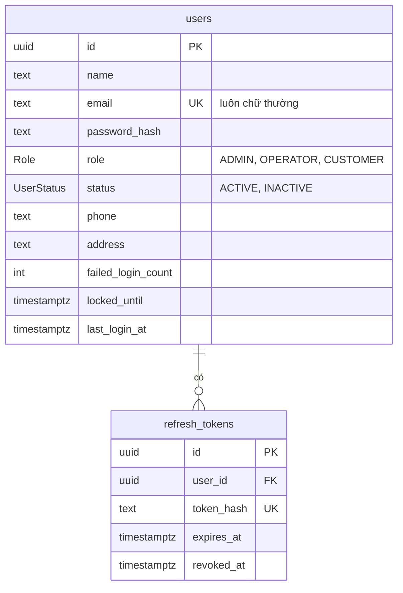
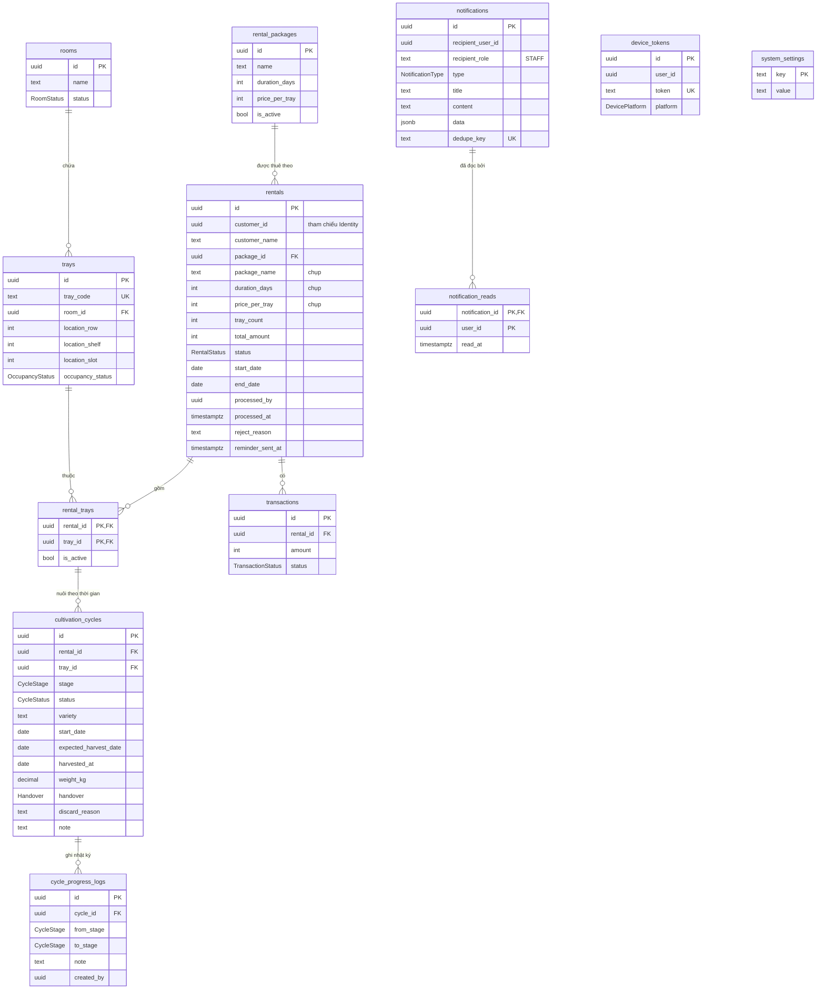
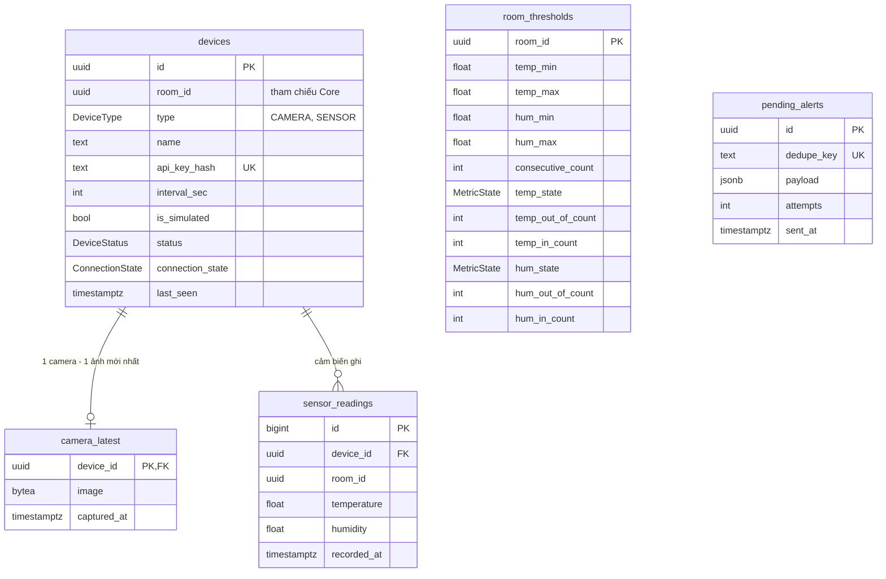

# Thiết kế cơ sở dữ liệu

Nguồn sự thật là **migration** trong `services/<service>/prisma/migrations/20261011090000_init/migration.sql`
(và `schema.prisma` bên cạnh). Tài liệu này giải thích ERD, những gì **khác SRS 8.1**, và ràng buộc nào do DB đảm nhiệm.
Dùng nó để cập nhật SRS v2.2.

## 1. Tổng quan

- **1 container PostgreSQL, 3 database riêng** (`identity_db`, `core_db`, `monitoring_db`), mỗi database một user riêng
  chỉ vào được database của mình. Không có khóa ngoại và không truy vấn chéo giữa các database; chỉ tham chiếu bằng UUID
  (`customerId`, `roomId`, `userId`).
- 19 bảng: Identity 2, Core 12, Monitoring 5.
- Quy ước chung:
  - Khóa chính **UUID do DB sinh** (`gen_random_uuid()`), trừ `sensor_readings` dùng `BIGSERIAL` (khối lượng lớn).
  - Mốc thời gian là `TIMESTAMPTZ(3)` (lưu UTC). Ngày nghiệp vụ (UTC+7) dùng `DATE`: `start_date`, `end_date`,
    `expected_harvest_date`, `harvested_at`.
  - Tiền tệ VND là `INTEGER`. Sản lượng `DECIMAL(8,2)` kg.
  - Enum của PostgreSQL cho mọi trạng thái (không dùng chuỗi tự do).
  - `updated_at` có `DEFAULT now()` và **trigger** cập nhật, đúng cả khi UPDATE bằng raw SQL.

## 2. ERD

### Identity (`identity_db`)



### Core (`core_db`)



`cultivation_cycles` tham chiếu **cặp** `(rental_id, tray_id)` của `rental_trays`: đợt nuôi chỉ tạo được cho khay thực sự
thuộc đơn đó. `device_tokens` và `system_settings` không có quan hệ với bảng khác.

### Monitoring (`monitoring_db`)



`room_thresholds` và `pending_alerts` không có khóa ngoại (khóa theo `room_id` của Core / khóa chống trùng).

## 3. Khác biệt so với SRS 8.1

Những điểm **cần cập nhật trong SRS v2.2**:

| #   | Thay đổi                                                                                                                                                          | Lý do                                                                                       |
| --- | ----------------------------------------------------------------------------------------------------------------------------------------------------------------- | ------------------------------------------------------------------------------------------- |
| 1   | **3 database riêng** thay vì 3 schema trong 1 database (8.1, 8.2). Vẫn 1 container PostgreSQL.                                                                    | Nhóm đã chốt; đáp ứng "database per service" rõ ràng hơn, DB chặn truy vấn chéo.            |
| 2   | `User` thêm `failedLoginCount`, `lockedUntil`, `lastLoginAt`; `RefreshToken` có `tokenHash`, `expiresAt`, `revokedAt` (SRS chỉ ghi tên).                          | Khóa tạm 5 phút khi sai mật khẩu (UC-01); thu hồi refresh token.                            |
| 3   | `User.email` luôn chữ thường (CHECK).                                                                                                                             | Tránh trùng tài khoản khác hoa/thường. Ứng dụng phải `toLowerCase()` trước khi lưu.         |
| 4   | `Tray.location` tách thành 3 cột `locationRow/Shelf/Slot`, duy nhất trong phòng.                                                                                  | Truy vấn, ràng buộc trùng vị trí.                                                           |
| 5   | `Rental` thêm bản **chụp** `packageName`, `durationDays`, `pricePerTray`; thêm `processedBy`, `processedAt`.                                                      | Sửa/tắt gói không đổi đơn cũ; biết ai và khi nào xác nhận/từ chối.                          |
| 6   | `CultivationCycle` tham chiếu **cặp `(rentalId, trayId)`** của `RentalTray` (một khóa ngoại kép) thay vì hai khóa ngoại rời.                                      | Đảm bảo khay thuộc đúng đơn. Quan hệ logic "Rental 1–N Cycle", "Tray 1–N Cycle" giữ nguyên. |
| 7   | `CycleProgressLog` được định nghĩa đầy đủ: `fromStage`, `toStage`, `note`, `createdBy`.                                                                           | SRS chỉ ghi tên bảng.                                                                       |
| 8   | `Notification` thêm `title`, `data` (JSON để app điều hướng), `dedupeKey` (duy nhất). `NotificationRead` **đã có trong SRS**, giữ nguyên.                         | Idempotent cho cảnh báo/job (BR-14); điều hướng từ thông báo.                               |
| 9   | **Bảng mới `device_tokens`** (FCM token: `userId`, `token`, `platform`).                                                                                          | Gửi push bằng Firebase; đề bắt buộc, SRS đang để FR-43 ở mức C.                             |
| 10  | **Bảng mới `system_settings`** (khóa-giá trị), dùng cho ngày giả lập `demo_simulated_date`.                                                                       | FR-26 cần lưu ngày giả lập bền vững.                                                        |
| 11  | **Bảng mới `pending_alerts`** (Monitoring).                                                                                                                       | Giữ cảnh báo khi Core lỗi và thử lại (BR-14). SRS chưa có chỗ lưu.                          |
| 12  | `RoomThreshold` cụ thể hóa trạng thái/bộ đếm: `tempState`, `tempOutOfCount`, `tempInCount` và tương tự cho độ ẩm.                                                 | SRS ghi "kèm trạng thái và bộ đếm cho từng chỉ số".                                         |
| 13  | `Device.apiKeyHash` duy nhất; `DeviceCommand` **chưa có** (mức C).                                                                                                | Tra cứu/chống trùng khóa; giữ phạm vi.                                                      |
| 14  | Mục "Chuyển trạng thái đơn bằng cập nhật có điều kiện" nay có **thêm lớp bảo vệ ở DB** (trigger, mục 4). Ứng dụng vẫn nên `UPDATE ... WHERE status = <mong đợi>`. | Phòng thủ nhiều lớp.                                                                        |

Cần nhớ khi sửa mục 8.2: dòng "không xóa thiết bị/phòng/người dùng" nay được **DB thực thi bằng trigger**; dòng "push notification"
nên bỏ khỏi danh sách không thực hiện.

## 4. Ràng buộc do DB đảm nhiệm

Ứng dụng vẫn phải kiểm tra trước để trả lỗi rõ ràng (409 `INSUFFICIENT_TRAYS`, `INVALID_STATE`...). DB là tuyến phòng thủ cuối,
chống lỗi logic và truy cập đồng thời. Mọi ràng buộc dưới đây có test trong `services/*/test/db.test.js`
(chạy migration thật trên PostgreSQL bằng PGlite).

> **Đánh số BR theo SRS v2.1/v2.2.** Các comment `BR-03/BR-04/BR-07` trong migration `20261011090000_init` từng bị gán nhầm
> số (BR-03 là trạng thái **khay**, BR-04 là trạng thái **đơn thuê**, BR-06 gồm giai đoạn đợt nuôi và điều kiện thu hoạch,
> BR-07 là hết hạn/hoàn tất). Migration `20261011120000_correct_br_references` đã sửa thông báo lỗi của trigger; bảng dưới là
> đối chiếu đúng.

### Core

| Quy tắc                                                                                | Cơ chế                                                                    | Tên                                                  |
| -------------------------------------------------------------------------------------- | ------------------------------------------------------------------------- | ---------------------------------------------------- |
| **BR-01** Mỗi khay thuộc tối đa một đơn đang hiệu lực                                  | Partial unique index `rental_trays(tray_id) WHERE is_active`              | `uq_rental_trays_active_tray`                        |
| **BR-06** Mỗi khay tối đa một đợt `GROWING`                                            | Partial unique index `cultivation_cycles(tray_id) WHERE status='GROWING'` | `uq_cycles_growing_tray`                             |
| **BR-04** Vòng đời đơn: `PAID→ACTIVE\|REJECTED`, `ACTIVE→EXPIRED→COMPLETED`            | Trigger; cấm đổi chủ đơn, gói, giá, số khay, tổng tiền sau khi tạo        | `trg_rentals_rules`                                  |
| **BR-06** Giai đoạn chỉ tiến đúng một bước; đợt đã kết thúc bất biến                   | Trigger; CHECK cho nhật ký tiến độ                                        | `trg_cycles_rules`, `chk_progress_logs_transition`   |
| **BR-06** Chỉ thu hoạch khi `FRUITING`/`READY`, có sản lượng và bàn giao               | CHECK                                                                     | `chk_cycles_harvest`                                 |
| FR-14 Từ chối đơn bắt buộc có lý do; đơn đã xử lý có người xử lý                       | CHECK                                                                     | `chk_rentals_reject_reason`, `chk_rentals_processed` |
| FR-20 Loại bỏ đợt nuôi bắt buộc có lý do                                               | CHECK                                                                     | `chk_cycles_discard_reason`                          |
| Tổng tiền = đơn giá × số khay; số khay, số ngày > 0                                    | CHECK                                                                     | `chk_rentals_amounts`                                |
| **BR-05** `start/end` cùng có hoặc cùng không, `end >= start`; đơn đã xác nhận có ngày | CHECK                                                                     | `chk_rentals_dates`, `chk_rentals_confirmed_dates`   |
| Đợt nuôi chỉ tạo cho khay thuộc đơn                                                    | Khóa ngoại kép `(rental_id, tray_id)`                                     | `cultivation_cycles_rental_id_tray_id_fkey`          |
| Thông báo gửi đúng một đối tượng (người **hoặc** vai trò `STAFF`)                      | CHECK                                                                     | `chk_notifications_recipient`                        |
| **BR-14** Không tạo trùng thông báo                                                    | Unique `notifications.dedupe_key`                                         | `notifications_dedupe_key_key`                       |
| **BR-15** Không xóa phòng, gói, đơn, giao dịch, đợt nuôi, nhật ký                      | Trigger `BEFORE DELETE`                                                   | `trg_*_forbid_delete`                                |
| **FR-08** Chỉ xóa khay chưa từng thuộc đơn nào                                         | Khóa ngoại `RESTRICT` từ `rental_trays`                                   | —                                                    |

### Monitoring

| Quy tắc                                                                             | Cơ chế                                                              | Tên                                                             |
| ----------------------------------------------------------------------------------- | ------------------------------------------------------------------- | --------------------------------------------------------------- |
| **BR-09** Mỗi phòng tối đa một thiết bị `ACTIVE` mỗi loại                           | Partial unique index `devices(room_id, type) WHERE status='ACTIVE'` | `uq_devices_active_room_type`                                   |
| **BR-09** Không đổi phòng/loại sau khi tạo                                          | Trigger                                                             | `trg_devices_rules`                                             |
| **FR-28** Thiết bị `INACTIVE` luôn `OFFLINE`                                        | CHECK                                                               | `chk_devices_inactive_offline`                                  |
| **BR-10** Nhiệt độ −40..80 °C, độ ẩm 0..100 %                                       | CHECK                                                               | `chk_readings_temperature`, `chk_readings_humidity`             |
| **BR-10** Ảnh snapshot 1 byte..2 MB, mỗi camera một dòng                            | CHECK + khóa chính `device_id`                                      | `chk_camera_latest_image_size`                                  |
| **BR-12** Ngưỡng: đủ cặp min/max, `min < max`, trong khoảng cho phép; N trong 1..20 | CHECK                                                               | `chk_thresholds_temp`, `chk_thresholds_hum`, `chk_thresholds_n` |
| Chu kỳ gửi 1..3600 giây                                                             | CHECK                                                               | `chk_devices_interval`                                          |
| **BR-14** Không trùng cảnh báo chờ gửi                                              | Unique `pending_alerts.dedupe_key`                                  | `pending_alerts_dedupe_key_key`                                 |
| **BR-15** Không xóa thiết bị                                                        | Trigger                                                             | `trg_devices_forbid_delete`                                     |

### Identity

| Quy tắc                                             | Cơ chế         | Tên                                                          |
| --------------------------------------------------- | -------------- | ------------------------------------------------------------ |
| Email duy nhất và luôn chữ thường                   | Unique + CHECK | `users_email_key`, `chk_users_email_lowercase`               |
| **BR-15** Không xóa người dùng (chỉ vô hiệu hóa)    | Trigger        | `trg_users_forbid_delete`                                    |
| Refresh token: hash duy nhất, hạn sau thời điểm tạo | Unique + CHECK | `refresh_tokens_token_hash_key`, `chk_refresh_tokens_expiry` |

### Vẫn do ứng dụng đảm nhiệm

BR-02 (Customer chỉ thấy dữ liệu của mình), BR-03 (trạng thái khay), BR-07 (hết hạn và hoàn tất), BR-08 (quyền xem camera), BR-11 (3 chu kỳ => OFFLINE), N lần liên tiếp của
BR-12, BR-13 (job dọn 7 ngày), tính `endDate = startDate + durationDays`, chuyển trạng thái khay
(`AVAILABLE→RESERVED→RENTED→CLEANING→AVAILABLE`, BR-03), và toàn bộ giao dịch nhiều bước (đặt thuê, xác nhận, từ chối, hết hạn).

## 5. Ghi chú cho người cài đặt

- **Raw SQL không cần sinh id hay `updated_at`**: `INSERT INTO rooms (name) VALUES ($1)` là đủ.
- **Email phải chữ thường** trước khi `INSERT`/`UPDATE`.
- **Trigger và CHECK báo lỗi bằng SQLSTATE** `23514` (CHECK/trigger nghiệp vụ), `23505` (trùng), `23001` (cấm xóa/RESTRICT),
  `23503` (khóa ngoại). `libs/shared` đã ánh xạ các lỗi này sang `409 CONFLICT`/`INVALID_STATE` nếu bị lọt, nhưng hãy
  kiểm tra điều kiện trong service trước để trả mã lỗi chính xác.
- **Dọn dữ liệu dev**: dùng `docker compose down -v` (xóa volume). `DELETE` bị chặn bởi BR-15; `TRUNCATE` thì không (cẩn thận).
- **Thêm migration mới**: sửa `schema.prisma` rồi `npx prisma migrate dev --name <mô-tả>`. Ràng buộc nâng cao thêm bằng
  `--create-only` rồi sửa file SQL, giống migration `init`.
- **Không sửa migration đã được merge**; luôn tạo migration mới.

## 6. Kiểm tra migration khớp schema (làm một lần)

Migration `init` được viết theo đúng quy ước đặt tên của Prisma và đã chạy thật trên PostgreSQL, nhưng chưa được đối chiếu
bằng chính `prisma migrate` (môi trường soạn thảo không tải được engine của Prisma). Hãy kiểm tra trên máy nhóm:

```bash
docker compose up -d postgres
cd services/core
cp .env.example .env
npx prisma migrate dev          # áp dụng init, rồi so với schema.prisma
```

- Thấy **"Already in sync, no schema change or pending migration was found"** hoặc không sinh migration mới: khớp.
- Nếu Prisma **tạo thêm một migration** (báo drift): giữ nguyên migration đó, commit cùng `init`, và báo lại để cập nhật tài liệu.
  Nếu Prisma đòi **reset database**, đồng ý (chỉ là dữ liệu dev).
- Làm tương tự cho `identity` và `monitoring`. Có thể dùng `npx prisma migrate status` để xem tình trạng.
